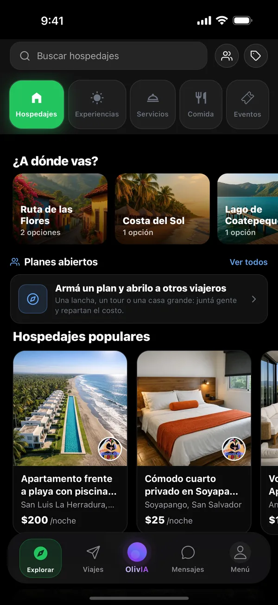
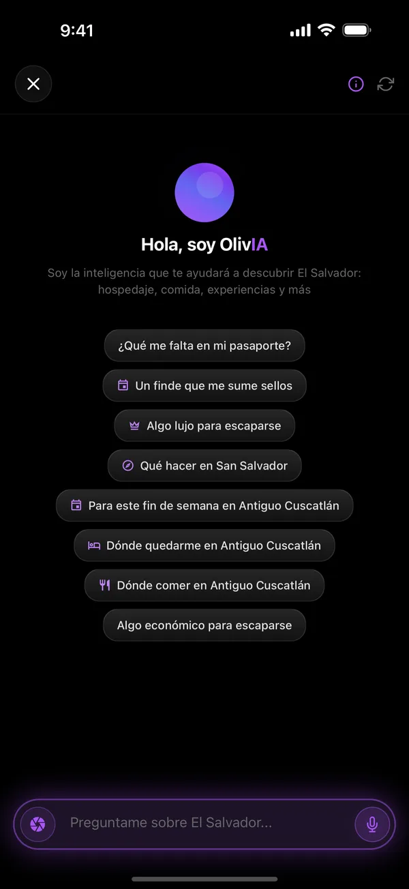
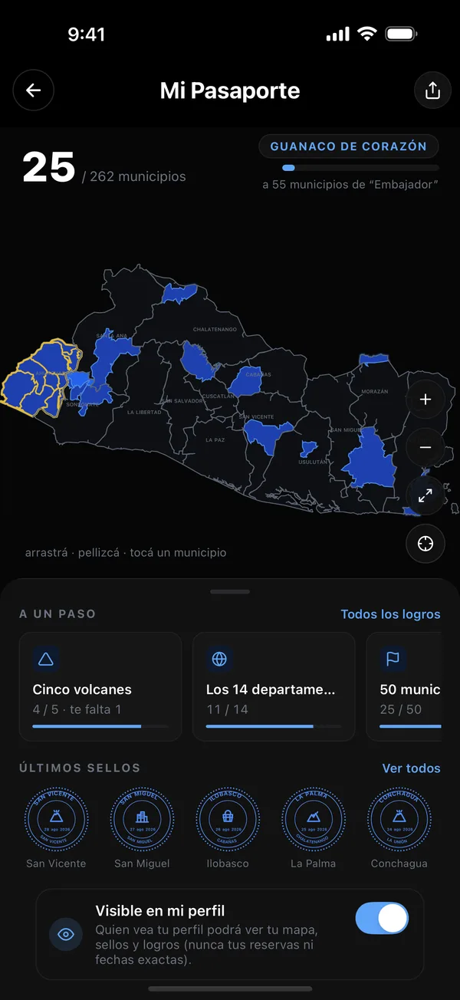
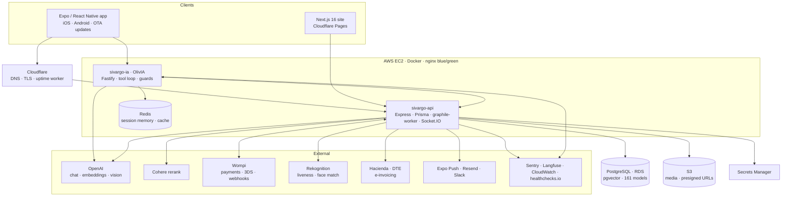
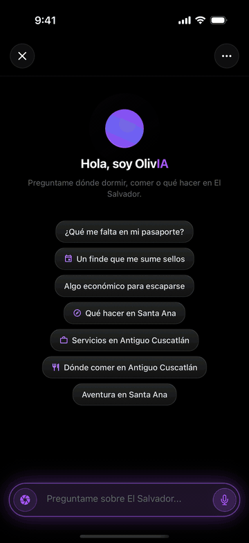
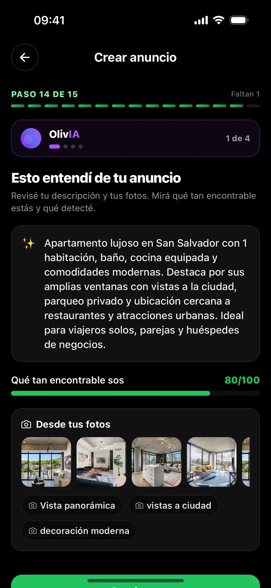
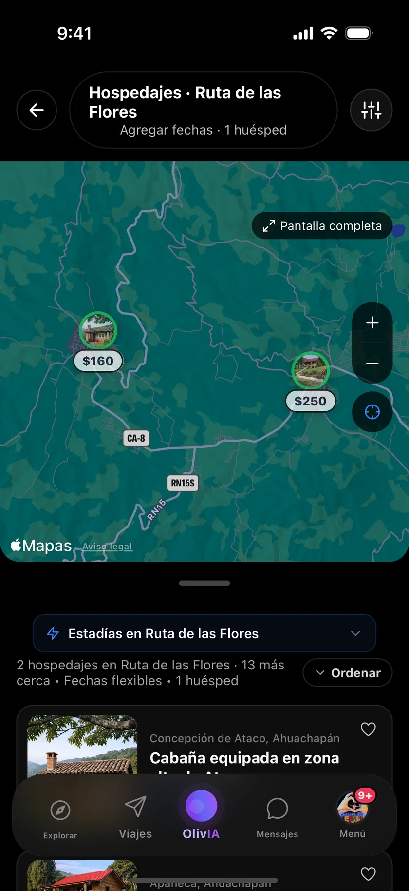
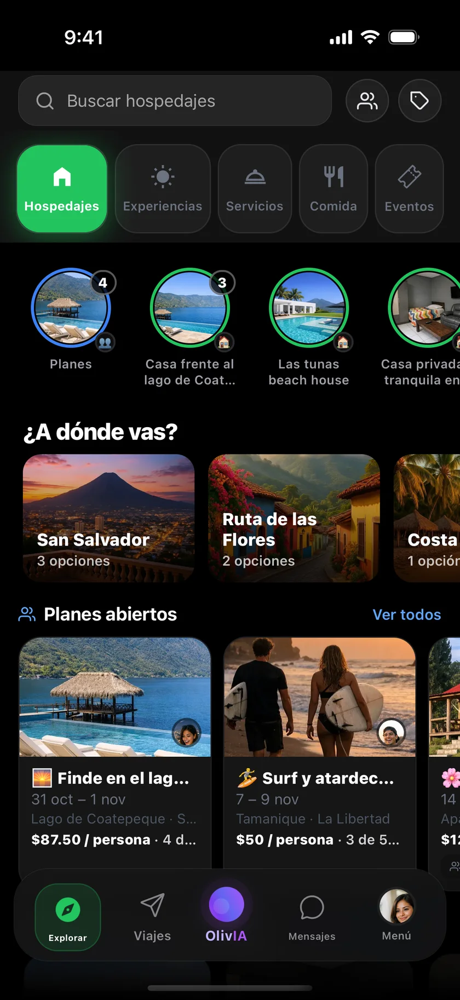
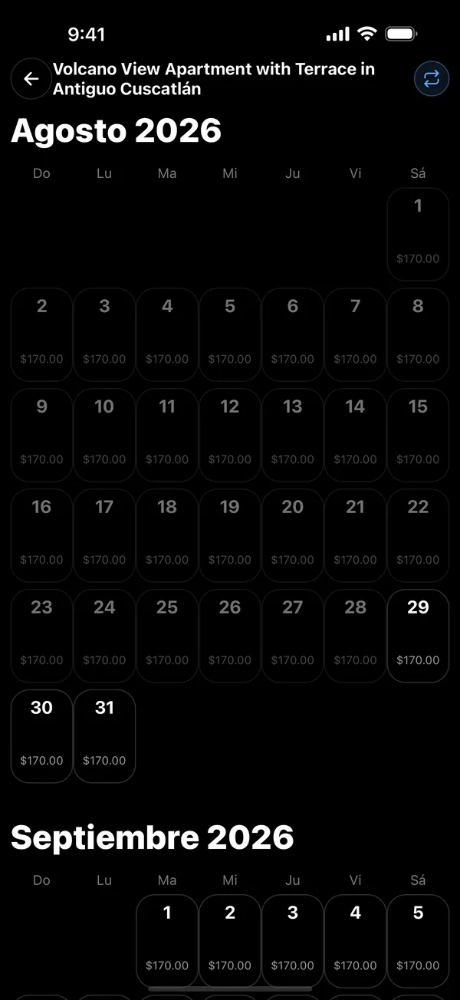

# SivarGO — AI-first travel marketplace for El Salvador (case study)

> A two-sided marketplace (iOS and Android) where travelers book **stays, experiences, services, food and events**, hosts run their business from the same app, and **OlivIA**, an AI concierge, finds and quotes things in natural language. Designed, built and operated by **one engineer** since November 2024. Web at [sivargo.com](https://sivargo.com).
>
> This repository documents architecture, decisions and numbers. The source is private.

**Role:** founder & sole engineer (product, mobile, API, AI service, infra, ops, fiscal) · **Stack:** React Native (Expo 54) · TypeScript · Express · Fastify · Prisma · PostgreSQL + pgvector · Redis · OpenAI · Cohere · AWS (EC2, RDS, S3, Secrets Manager, Rekognition, CloudWatch) · Docker · nginx · Cloudflare · GitHub Actions · EAS · Wompi · Langfuse · Sentry

  
  
  
  

---

## By the numbers

| Area | |
|---|---|
| Codebase | **700k+ lines of TypeScript** across 4 repos (API, mobile app, AI service, web), ~1,400 commits |
| Data model | **161 Prisma models**, 79 enums, **320 migrations** |
| API | **600+ REST endpoints**, 110 route files, ~70 scheduled jobs (graphile-worker), Socket.IO realtime |
| Mobile app | **379 screens** (expo-router), 2 languages × **16,201 i18n keys** |
| AI concierge | **25 tools**, split-model agent loop, 23 knowledge docs, 240 eval cases across 3 banks |
| Tests | **~5,000 API tests** (146 integration suites on ephemeral Postgres+pgvector), **~2,000 app tests**, **~700 AI-service tests** |
| Ops | Blue/green deploys, 20+ automated alerts, daily backups with monthly restore verification, external uptime watchers |

## Architecture

Inside the API, dependencies point inward: routes → controllers → services → **`core/`**, a pure business-rules layer (pricing, refunds, calendar rules, fiscal matrix) with no I/O, covered by golden-master tests and a CI coverage floor.

## OlivIA: the AI concierge

  
  
  

OlivIA is not a chatbot with a search box. It is an agent with **25 typed tools** (search per category and across all, quote, availability, seats, details, reviews, menus, packages, promotions, bookings, favorites, notifications, watches, open a support ticket, start a conversation with a host, ask the user) over the live catalog.

**Decisions that made it reliable**

- **Split-model loop.** A fast, cheap model runs the tool loop; a stronger model writes the final answer from the tool results ("draft handoff"). Hard rule in the system prompt: prices come only from tool results, never from the model.
- **Hybrid retrieval, reranked.** Keyword scoring + pgvector similarity (OpenAI embeddings, 1536-d) + commercial boosts, then **Cohere rerank** with a 1.8 s timeout and graceful degradation. Irrelevant items are pushed down, never silently dropped.
- **Vocabulary router.** The taxonomy of all five categories is compiled into a vocabulary; if a word exists in more than one category ("mesa", "tour"), the code forces a cross-category search instead of trusting the model to pick.
- **Geo anchoring.** If every result is far from the place the user asked about ("near El Tunco"), cards are suppressed and the user gets an honest answer with real zone options, rather than a confident wrong list.
- **Topic-shift detection in code.** Each turn decides deterministically whether this is a new topic, so city, dates, guests and budget from the previous question do not leak into the next.
- **Deterministic guards** for guide mode, foreign places, impossible dates, zero guests, emergencies (911, tourist police), contact-sharing requests, repeated messages and prompt injection.
- **Session memory in Redis** (30-minute TTL, write-through, survives deploys) and **spend guardrails**: cache → abuse → burst → monthly budget, with a zero-cost fallback responder when the budget is exhausted. Rate limits are keyed by verified identity, never by client headers.
- **SSE streaming** from the same pipeline as the JSON endpoint.
- **Multimodal.** "Point and ask": photograph a dish, a volcano or a sign and OlivIA turns it into a search. On the host side, listing assist analyzes title, description and photos and proposes taxonomy tags with a findability score; photo-derived tags start unchecked so hosts confirm what is true.

**Evals.** Three question banks (94 scripted questions, 87 and 58 persona-driven cases: novice, expert QA, AI programmer, tour guide), multi-turn support, deterministic checks in CI, and an **LLM-as-judge** with 3-vote majority. Judge scores rose from **3.45/5 to 4.38/5** across eval loops, with every run traced in **Langfuse** (generations, tool spans, latency, cost).

## The marketplace

  
  
  
  

- **Five categories, one engine.** A per-category descriptor drives pricing (nightly, per person, package, ticket), the shared detail screen and the AI adapters.
- **Bookings:** request → accept → pay, with server-side price recomputation against tampering, integer cents, half-open date ranges in El Salvador time, change requests, extra-money requests, no-shows, and a no-payment path for the professional directory.
- **Money is a double-entry ledger.** `LedgerTransaction` / `LedgerLine` / `AccountBalance` are the source of truth, balances update in O(1) inside each transaction, and a daily drift check alerts on any disagreement. Refunds run in serializable transactions.
- **Cancellation policies** live in the database as four tiers; `evaluateRefund` is a pure function with golden tests. Host cancellations refund 100% and block the calendar as a penalty.
- **Host wallet and payouts:** pending → available → payout hold buckets, encrypted bank keys with rotation, payout batches with evidence, alerts on stale requests.
- **Payments:** Wompi payment links and tokenized cards with signed webhooks, ghost-payment detection, hourly and daily reconciliation, and a 3DS flow. Apple in-app purchases for memberships.
- **Electronic invoicing (DTE)** for El Salvador's tax authority: SivarGO invoices as an intermediary on behalf of hosts. Builders and validators for 7 document types, sequences, a 2-minute transmission cycle, contingency mode, PDFs, period close and per-host fiscal reports.
- **Group plans:** members, date and item voting, linked bookings, shared expenses with settle-up, plan chat, shareable landing pages.
- **Passport:** a personal map of 14 departments and 262 municipalities. A stamp requires real presence (a check-in, a seated reservation or a scanned ticket) matched against municipality polygons.
- **Stories, moments, coupons, credits, referrals, reviews, favorites, creator collaborations, iCal import/export, restaurant reservations with menu digitization, directory appointments with waitlists.**
- **Trust and safety:** identity verification (document OCR, duplicate fingerprinting, Rekognition liveness and face match, manual review) gating hosting and payouts; a chat contact detector that blocks off-platform contact before booking; report/block flows; an in-app support panel with tickets, disputes, fraud and CSAT; an admin panel for finance, payouts, refunds and moderation.

## The web (sivargo.com)

A static **Next.js 16** site on Cloudflare Pages, Spanish at the root and English under `/en`, with type-enforced matching keys across both languages and per-category copy for the five verticals. It hosts an **interactive demo** of the app ([sivargo.com/en/demo](https://sivargo.com/en/demo)) built from real screenshots in both languages, a help center and legal texts synced from the product repos, a waitlist form against the API, and analytics loaded only after cookie consent. An independent Cloudflare Worker pings the API and the AI service every minute as an external uptime watcher.

## Operations on a one-person budget

- **CI/CD:** typecheck, dependency-cycle ratchet, unit tests with a coverage floor, integration tests on an ephemeral Postgres+pgvector container with signed webhook fixtures, gitleaks and `npm audit`, then an SSH blue/green deploy. The app ships binaries through EAS Build and JavaScript through EAS Update, with Sentry sourcemaps.
- **Blue/green on one EC2:** build, start the other color, health-check for 90 s, swap the nginx upstream, `nginx -t`, graceful reload, drain, stop the old container.
- **Security:** AWS Secrets Manager at boot, EC2 instance role instead of static keys, MFA-only admin role, rate limiters persisted in Postgres so they survive deploys, Cloudflare-aware client IP handling, idempotency keys, a security audit log, S3 Object Lock on backup replicas.
- **Observability:** host, RDS and EC2 credit metrics every 5 to 15 minutes, a "watcher went blind" alert if CloudWatch itself fails, an OpenAI balance canary, certificate and license expiry watches, ledger drift, job-runner death alerts, client-side JS errors from real phones, all routed to Slack, rate-limited email and Sentry. Dead-man's switches on healthchecks.io and an independent Cloudflare Worker ping every minute.
- **Backups:** daily at 03:10 with failure alerts and a **monthly automated restore-verify** job plus a runbook.

## Lessons

- Put the invariants you cannot afford to break in code with no I/O, and test them with golden masters. Money and calendars never regress silently that way.
- An LLM agent gets reliable through the boring parts: typed tools, deterministic guards, evals in CI and tracing on every call. The model is the least controllable component, so control everything around it.
- One engineer can run production if the system watches itself. Every alert above exists because something once failed quietly.
- Localisation from day one (16k keys, voseo Spanish and English) was cheaper than retrofitting it.

---

Walter Salazar · [GitHub profile](https://github.com/wsalazar1989) · [LinkedIn](https://www.linkedin.com/in/waltersalazarg1989) · [NutriChef case study](https://github.com/wsalazar1989/nutrichef-case-study)
